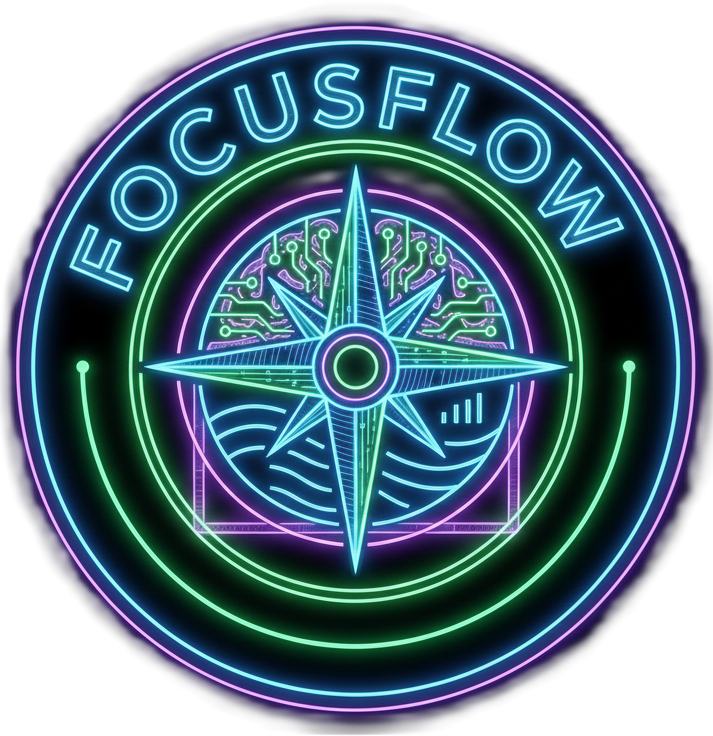

<!-- Banner (optional) -->
<!-- Replace the path below with your actual banner if you add one, e.g. /public/focusflow-banner.png -->
<p align="center">
  
</p>

<h1 align="center">FocusFlow</h1>
<p align="center">
  Minimalist focus & productivity web app built for deep work.
</p>

<p align="center">
  
  
  
  
  
  
</p>

---

## ✨ Overview

**FocusFlow** is a personal focus companion:  
a minimalist web app that:

- Times your deep work sessions  
- Plays looping focus music  
- Shows motivational quotes  
- Tracks your study time with charts  
- Lives entirely in your browser using `localStorage`

No login, no backend (for now) — just open and focus.

---

## 🎯 Features

### ⏱ Focus Timer
- Digital **HH:MM:SS** timer
- Glassmorphism ring around the clock
- Start / Pause / Stop buttons with Icons8-style SVG icons
- Session saving:
  - Each **Stop** stores a session (duration + timestamp + tag)
- **Timer state persists** on refresh using `localStorage`

### 🎧 Flow State Music
- Single track: `public/audio/flowstate.mp3`
- Loops seamlessly
- Music toggle button in bottom-right:
  - Animated soundwave ring when playing
  - Controlled by click **and** keyboard (`M`)

### 💬 Motivational Quotes
- Random quote displayed below timer
- Smooth fade-in / fade-out at intervals
- Minimal, non-distracting styling

### 📊 Dashboard Analytics
- Daily / weekly / monthly breakdown
- Charts built with **Recharts**
- Summary cards:
  - Total time today
  - Last 7 days
  - Current month
  - Longest session
- Recent sessions list with timestamps + tags
- All backed by `localStorage` (no backend needed)

### 🎹 Keyboard Shortcuts

**Global / App-wide**
- `F` → Go to **Focus** page  
- `D` → Go to **Dashboard**  

**On Focus Page**
- `Space` → Start / Pause timer  
- `Shift + Space` → Stop & Save session  
- `M` → Toggle music on/off  
- `/` → Focus the tag input

A **keyboard shortcuts tooltip** (keyboard icon) appears on desktop in the bottom-left, showing all shortcuts.

---

## 🧱 Tech Stack

- **Frontend:** React + Vite  
- **Styling:** Tailwind CSS  
- **Charts:** Recharts  
- **State & Persistence:** React hooks + `localStorage`  
- **Media:** Background GIF (`/public/bg.gif`) and focus music (`/public/audio/flowstate.mp3`)

Planned future stack (when backend is added):

- Node.js, Express, MongoDB for:
  - Multi-device sync
  - User accounts
  - Cloud-stored sessions and coins

---

## 🖼 UI Highlights

- Dark, dev-friendly aesthetic  
- Gradient background with ambient blobs  
- Blurred, glassy components (timer, panels, tooltip)  
- Full-screen **focus page**:
  - Centered timer
  - Background GIF
  - Minimal wording
- Separate **dashboard** view with cards + charts

---


## ⚙️ Getting Started

### 1️⃣ Install dependencies

```bash
npm install
```

### 2️⃣ Run dev server

```bash
npm run dev
```

Vite will print the local dev URL (usually `http://localhost:5173`).

---

## 🗺 Roadmap

Planned upgrades:

* [ ] **Coins system** – convert focus minutes into in-app currency
* [ ] **Store** – unlock themes, backgrounds, sounds with coins
* [ ] **Streaks & achievements**
* [ ] **Custom focus modes** (Pomodoro, ultra-focus, etc.)
* [ ] **Backend sync** (Node.js + Express + MongoDB)
* [ ] **User accounts** for multi-device tracking

---

## 🤝 Contributing

This is currently a personal project, but if you want to:

* Add new themes / backgrounds
* Improve the charts
* Extend keyboard shortcuts
* Help with backend integration

feel free to fork and open a PR.

---

## 📄 License

This project is licensed under the **MIT License**.
You’re free to use, modify, and build on it.

---

## 💡 Inspiration

Built for personal deep work and study sessions.
Designed to be **simple enough to open and start**, but **powerful enough** to actually track your consistency.

---
